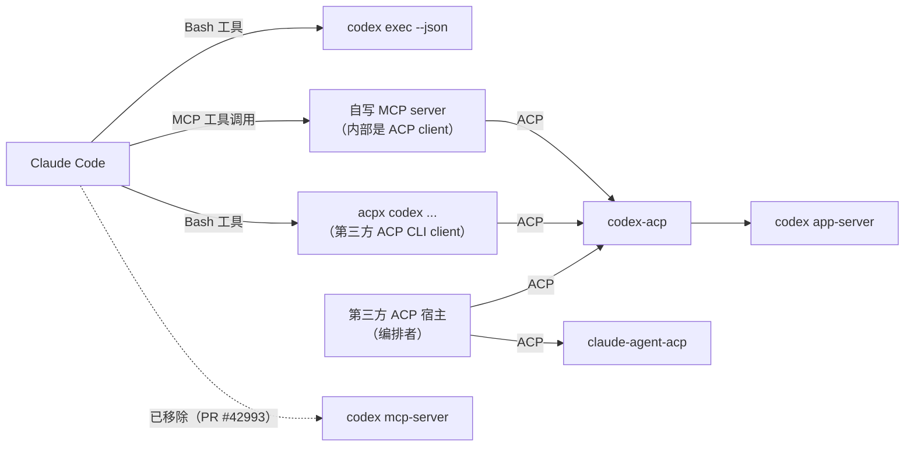

# Claude 能否通过 ACP 指挥 Codex 调研

调研日期：2026-10-16

本机核对版本：`codex-cli 0.162.1`、`Claude Code 2.1.300`。

## 结论

- **没有现成的直接路径。** ACP 是“宿主（Client）驱动 Agent”的协议。Claude Code 和 Codex 在 ACP 里都只以 **Agent** 身份出现，而且都要靠适配器（`claude-agent-acp`、`codex-acp`）。Claude Code 官方文档里没有任何 ACP client 能力。两个 Agent 之间没有直连通道。[R1][R3][R9][R10]
- **Codex 确实可以作为 ACP Agent 被驱动**：官方 ACP 组织维护的 `@agentclientprotocol/codex-acp` 会启动 Codex App Server，把 ACP 请求翻译成 Codex 操作。[R4][R5]
- **重要变化：`codex mcp-server` 已被移除。** openai/codex PR #42993（2026-09-05 合入）删掉了该子命令和 `codex-mcp-server` crate；官方文档页也写明已移除。本机 0.162.1 的 `codex --help` 里确实没有它。所以“Codex 当 MCP server 给 Claude 用”这条老路，在当前版本已不可用。[R6][R7]
- **今天可行的间接路径**，按投入从低到高排：(b) Claude 用 Bash 调 `codex exec`；(c) 写一个 MCP server，内部当 ACP client 连 `codex-acp`，再把它暴露成 Claude 的工具（或者让 Claude 用 Bash 调第三方 ACP CLI 客户端 `acpx`）；(d) 由第三方 ACP 宿主同时托管两个 Agent，并由宿主做编排。
- 本仓库是一个 **单后端 ACP client**（只连 `dsh --profile zf-tui`）。它在 (d) 里的位置是“宿主”，但目前不具备多 Agent 编排能力。

一句话总结：ACP 只有“宿主 → Agent”这一个方向；Claude 想指挥 Codex，必须有人在中间扮演 ACP client，这个人可以是 MCP 包装器、CLI 脚本或第三方宿主。

## 角色关系图

### ACP 的基本角色

```text
            JSON-RPC over stdio（本地子进程）
 ┌──────────────┐   initialize / session/new / session/prompt / session/cancel   ┌──────────────┐
 │  ACP Client  │ ─────────────────────────────────────────────────────────────▶ │  ACP Agent   │
 │ （编辑器/宿主）│ ◀───────────────────────────────────────────────────────────── │ （编码 Agent）│
 └──────────────┘   session/update 通知、session/request_permission、           └──────────────┘
                    fs/*、terminal/*（需要 Client 声明能力）
```

ACP 文档把 Client 定义为用户所在的编辑器，把 Agent 定义为被带进编辑器的编码 Agent；本地 Agent 是编辑器的子进程，通过 stdio 上的 JSON-RPC 通信。[R1][R2]

### 现实中各方的位置

```text
                         ┌───────────────────────────────┐
                         │      ACP Client（宿主）          │
                         │  Zed / acpx / 本仓库 TUI / ...  │
                         └──────┬─────────────────┬──────┘
                    ACP (stdio) │                 │ ACP (stdio)
                                ▼                 ▼
                 ┌──────────────────────┐  ┌──────────────────────┐
                 │  claude-agent-acp    │  │  codex-acp           │
                 │ （适配器，ACP Agent）  │  │ （适配器，ACP Agent）  │
                 └──────────┬───────────┘  └──────────┬───────────┘
                            │ Claude Agent SDK        │ Codex App Server 协议（非 ACP）
                            ▼                         ▼
                      Claude Code 引擎            codex app-server

   Claude Code ──X──▶ codex-acp      ← 不存在：Claude Code 没有原生 ACP client 能力
```

### 让 Claude “指挥” Codex 的几条桥



## 关键事实逐条核对

### 1. ACP 的角色模型

- Client = 编辑器/IDE，Agent = 编码 Agent。本地 Agent 作为编辑器子进程运行，用 stdio 上的 JSON-RPC 通信；远程传输仍在完善中。[R1]
- Agent 侧方法：`initialize`、`authenticate`、`session/new`、`session/load`（需 `loadSession` 能力）、`session/prompt`、`session/cancel`（通知）。[R2]
- Client 侧方法：`session/request_permission`、`fs/read_text_file` / `fs/write_text_file`（需 `fs` 能力）、`terminal/*`（需 `terminal` 能力）。Agent 通过 `session/update` 通知报告进度。[R2]
- 一个 prompt turn 以 `session/prompt` 的响应结束，stop reason 有 `end_turn`、`max_tokens`、`max_turn_requests`、`refusal`、`cancelled`。[R11]
- 取消：Client 随时发 `session/cancel`；Client 必须把所有挂起的权限请求回答为 cancelled；Agent 尽快停止，并用 `cancelled` stop reason 回复原 `session/prompt`。[R11]

结论：**ACP 是不对称协议**。只有 Client 能发起会话和 prompt。“A Agent 指挥 B Agent”必须让 A 一侧有一个 Client 实现。

### 2. Claude Code 在 ACP 中只是 Agent

- ACP 官方 Agent 列表把 “Claude Agent” 标为 “via Zed's SDK adapter”。[R3]
- 适配器仓库现在位于 `agentclientprotocol/claude-agent-acp`（原 `zed-industries/claude-code-acp` 链接会跳到这里），README 写的是 “implements an ACP agent by using the official Claude Agent SDK”，npm 包为 `@agentclientprotocol/claude-agent-acp`。[R9]
- ACP 官方 Client 列表里**没有** Claude Code 自己的条目；Claude Code 只出现在其他宿主的描述里（例如 Jockey “coordinates Claude Code, Gemini CLI, and Codex CLI via ACP”）。[R10]
- Claude Code 文档索引 `llms.txt` 中搜不到 “ACP”、“Agent Client Protocol”、“Zed”。本机 `claude --help` 中也没有任何 ACP 相关选项。[R12]
- Claude Code 能做的协议角色是：MCP client（`claude mcp add`）、MCP server（`claude mcp serve`）、headless CLI（`claude -p --output-format stream-json`）、Agent SDK。[R13][R14]

**未确认**：Claude Code 是否有未公开或实验性的 ACP client 功能。依据只有公开文档索引和 CLI 帮助，无法证明内部不存在。

### 3. Codex 作为 ACP Agent（codex-acp）

- ACP 官方 Agent 列表把 “Codex CLI” 标为 “via ACP's adapter”，链接 `agentclientprotocol/codex-acp`。[R3]
- 旧仓库 `zed-industries/codex-acp` 已归档，README 写 “Development has moved to agentclientprotocol/codex-acp”，新装应使用 `@agentclientprotocol/codex-acp`。[R4]
- 新仓库 README：“It starts the Codex App Server, translates ACP requests into Codex operations”；支持 ChatGPT 登录、`CODEX_API_KEY`/`OPENAI_API_KEY`、可配置 model / reasoning effort / approval / sandbox；在 `initialize` 协商后支持原生 ACP 子 Agent 会话；npm 包内捆绑兼容的 `@openai/codex`，可用 `CODEX_PATH` 覆盖。运行：`npx -y @agentclientprotocol/codex-acp`。[R5]
- Codex App Server 是 Codex 自己的 JSON-RPC 协议（`thread/start`、`turn/start`、`turn/interrupt` 等），**不是 ACP**；VS Code 扩展用它。[R8]

**未确认**：`codex-acp` 是否支持通用的 `session/load` 恢复会话。README 只在子 Agent 会话的上下文里提到 `session/load`。[R5]

### 4. `codex mcp-server` 已移除

- openai/codex PR #42993 “Remove the deprecated `codex mcp-server` command”，2026-09-05 合入：删除子命令、独立的 `codex-mcp-server` crate 及其测试、接口文档和构建依赖。[R6]
- 官方文档页（`developers.openai.com/codex/guides/agents-sdk` 现跳转到 `learn.chatgpt.com/docs/mcp-server`）写道：“The `codex mcp-server` command and the standalone `codex-mcp-server` binary have been removed.” 原先的 MCP 工具参考和 Agents SDK 示例不再受支持；官方建议改用 App Server，但该页同时说明 App Server “experimental and not supported for production workloads”。[R7]
- 本机 `codex 0.162.1` 的子命令列表里只有 `mcp`（管理 Codex 自己使用的外部 MCP server）和 `app-server`，没有 `mcp-server`。
- 当前 `codex-rs/` 目录下也已没有 `mcp-server` crate。[R15]

**未确认**：哪个正式 release 是最后一个仍带 `mcp-server` 的版本。没有逐个核对 release 内容。

### 5. `codex exec`（非交互模式）

- 进度写 stderr，最终消息写 stdout；`--json` 让 stdout 变成 JSONL 事件流，事件包括 `thread.started`、`turn.started`、`turn.completed`、`turn.failed`、`item.*`、`error`。[R16]
- 默认在只读沙箱里运行；要改文件需 `--sandbox workspace-write`。`--full-auto` 已不再支持，改用 `--sandbox workspace-write` 或 `--approve-for-me`（把审批交给自动审核）。[R16]
- `codex exec resume <SESSION_ID>` 续接会话；`-o/--output-last-message` 写最终消息到文件；`--output-schema` 要求最终回答符合 JSON Schema。[R16]
- 本机 `codex exec --help` 同样列出 `--json`、`-s/--sandbox`、`--approve-for-me`、`--output-schema`、`-o`、`resume`。

**未确认**：`codex exec` 的取消语义。官方页面没写；可推测靠结束进程，但被杀时的副作用状态需要自行核实。

### 6. Claude Code 一侧的相关限制

- **Bash 工具**：前台命令默认超时 2 分钟，上限默认 10 分钟（`BASH_DEFAULT_TIMEOUT_MS`、`BASH_MAX_TIMEOUT_MS`）；超时的前台命令会转入后台而不是被杀。无人值守会话（如 `-p`）中后台命令默认 30 分钟、最长 2 小时。有效输出内联约 30,000 字符，超出部分落盘。[R17]
- **MCP 工具**：stdio server 用 `claude mcp add <name> -- <command> [args...]` 添加；每个 server 可在 `.mcp.json` 里设 `timeout`（毫秒）作为单次调用的硬墙钟上限，progress 通知不会延长它；未设时回落到 `MCP_TOOL_TIMEOUT`，默认约 28 小时。输出超过 10,000 token 告警，默认 25,000 token 上限（`MAX_MCP_OUTPUT_TOKENS`）。[R13]
- **MCP elicitation**：Claude Code 支持响应 MCP elicitation（文档有 “Respond to MCP elicitation requests” 一节，正文本次未读全）；`--permission-prompts none` 时，没有 `Elicitation` hook 回答的 elicitation 会被取消。[R13][R14]

## 路径对比

| 路径 | 机制 | 是否走 ACP | 权限审批 | 会话 | 流式输出 | 取消 | 主要优点 | 主要缺点 / 限制 |
| :- | :- | :- | :- | :- | :- | :- | :- | :- |
| (a) `codex mcp-server` 作 MCP 工具 | Claude Code 作 MCP client 调 Codex 暴露的工具 | 否 | 旧版依赖 MCP elicitation | 旧版有 `codex` / `codex-reply` 工具 | 仅 MCP 进度通知 | MCP 取消 | 曾经零代码 | **当前版本已移除**（PR #42993）；只能锁旧版 Codex，不建议 |
| (b) Bash 调 `codex exec` | Claude 生成命令，Bash 工具执行子进程 | 否 | 无交互审批；只能预先选沙箱或 `--approve-for-me` | `codex exec resume <ID>` 续接 | `--json` JSONL，但 Claude 要等命令结束（或转后台后读文件）才能看到 | 杀进程或停后台任务；语义未确认 | 零开发、官方支持、可结构化输出 | 无逐步审批；长任务受 Bash 超时与后台时限影响；输出过长会落盘 |
| (c1) 自写 MCP server，内部当 ACP client 连 `codex-acp` | Claude 调 MCP 工具 → 包装器发 `session/prompt` → 汇总 `session/update` 返回 | 是（包装器 ↔ codex-acp） | 包装器收到 `session/request_permission` 后，可映射为 MCP elicitation 给用户，或按策略自动选 | 包装器自己保存 ACP `sessionId`，可做“多轮工具” | 可把 `session/update` 转成 MCP 进度通知；Claude 最终只拿到工具结果 | MCP 取消 → `session/cancel`；Claude Code 是否在用户中断时发 MCP 取消，**未确认** | 唯一真正“通过 ACP 驱动 Codex”的 Claude 侧方案；审批语义最完整 | 要自己写和维护；`codex-acp` 底下的 App Server 被标为实验性；MCP 输出上限与单次超时需配置 |
| (c2) Bash 调 `acpx codex ...` | 第三方 ACP CLI client 负责 ACP，Claude 只调命令 | 是（acpx ↔ codex-acp） | acpx 提供审批策略（approve-all / deny 等），无逐条人工审批 | acpx 持久化命名会话（`~/.acpx/`） | `--format json` 输出 NDJSON ACP 事件 | acpx 文档提到但未展示，**未确认** | 不写代码即可走 ACP | 第三方工具，未做安全与稳定性核实；仍受 Bash 超时限制 |
| (d) 第三方 ACP 宿主同时托管两者 | 宿主作 ACP client，同时连 `claude-agent-acp` 与 `codex-acp`，自己做编排 | 是（两条都是） | 宿主统一处理两边的 `session/request_permission` | 宿主各自管理两个会话 | 两边 `session/update` 都进宿主 | 宿主对任一侧发 `session/cancel` | 审批、取消、流式最一致；两边对等 | Claude **不是**指挥者，编排逻辑在宿主；要么用现成多 Agent 宿主（如 Jockey），要么自己实现 |

### 怎么选

- 只想“让 Claude 偶尔把一段活交给 Codex” → (b)，最省事。
- 想保留 Codex 的逐步审批和流式进度，并且仍由 Claude 决策 → (c1)。
- 想让两个 Agent 对等协作、由程序决定谁做什么 → (d)。
- (a) 只适合已锁定旧版 Codex 的现有环境。

## 细节：(c1) 包装器的最小流程

```text
Claude Code                 MCP 包装器（ACP client）                 codex-acp
    │ tools/call codex_run       │                                      │
    │──────────────────────────▶ │ spawn + initialize                    │
    │                            │─────────────────────────────────────▶ │
    │                            │ session/new {cwd}                     │
    │                            │─────────────────────────────────────▶ │
    │                            │ session/prompt                        │
    │                            │─────────────────────────────────────▶ │
    │   notifications/progress   │ ◀─── session/update（文本、工具、计划）│
    │ ◀──────────────────────────│                                      │
    │   elicitation（可选）       │ ◀─── session/request_permission       │
    │ ◀──────────────────────────│ ───▶ 选中的 optionId 或 cancelled      │
    │   tools/call 结果           │ ◀─── session/prompt 响应 {stopReason} │
    │ ◀──────────────────────────│                                      │
```

要点：

1. 包装器可以用官方 Rust crate `agent-client-protocol` 实现 Client 一侧；该库同时实现协议两端。[R18]
2. 包装器声明的 `clientCapabilities` 决定 `codex-acp` 能否请求 `fs/*`、`terminal/*`；不声明就由 Agent 自己处理文件与命令。[R2]
3. MCP 单次调用的超时是硬上限，progress 通知不延长它；长任务要把 `.mcp.json` 的 `timeout` 设大。[R13]
4. 取消时必须先把挂起的权限请求回答为 cancelled，再等 `session/prompt` 返回 `cancelled`，不能把取消当成功或失败。[R11]

## 本仓库在 (d) 中的位置

只读核查 `src/backend/acp.rs`、`src/backend/acp_protocol.rs` 和 `docs/native-agent-tui-acp.md` 的结果：

- **角色**：本仓库是 ACP **Client（宿主）**。`launch_with_tail` 用 `Command::new(&config.dsh_executable)` 加参数 `--profile <acp_profile>` 启动子进程，经 `PipeTransport` 收发换行分隔的 JSON-RPC（`src/backend/acp.rs` 第 63–90 行附近）。
- **后端**：只有一个后端 `dsh --profile zf-tui`。文档写明 “dsh is the only backend since 2026-10-12; the Codex backend was removed”；`zf-tui-bridge` 插件处理 `zf/*` 方法，其余帧转给 dsh 自己的 ACP server（`docs/native-agent-tui-acp.md`）。
- **映射的 ACP 方法**：`initialize`、`session/new`、`session/prompt`、`session/update`、`session/request_permission`、`session/cancel`、`session/close`、`session/set_config_option`。prompt turn 是单飞的；取消通知不会被当成 turn 完成，只有 stop reason 或断连才结束 turn（同上文档）。
- **能力声明**：`initialize` 里 `clientCapabilities` 是空对象（`src/backend/acp_protocol.rs` 第 110–111 行），即不向 Agent 提供 `fs/*` 或 `terminal/*`。
- **权限**：`permission()` 会拒绝不属于当前活动会话的权限请求，其余转成 Core 的审批事实交给 UI（`src/backend/acp.rs` 第 2075 行起）。

因此：

- 它具备 (d) 需要的“宿主”底座：子进程管理、单 owner 写入、权限转发、取消语义。
- 它**还不是**多 Agent 编排宿主：同一时刻只有一个 ACP 子进程和一个活动会话，没有在两个 Agent 之间路由任务的逻辑。
- **未确认**：把 `--dsh` 指向 `codex-acp` 能否直接工作。推断不能开箱即用，原因是启动时固定追加 `--profile` 参数，且桥接层依赖 dsh 插件的 `zf/*` 方法（会话列表、技能目录等）；这只是读代码得出的推断，没有实际运行验证。
- 按项目记忆，会话管理与插件应优先复用 dsh；若要做 (d)，更自然的位置可能是 dsh 侧（例如 dsh 插件内再起一个 ACP client 连 `codex-acp`），而不是在 TUI 里新增第二套后端。这是设计建议，不是已核实事实。

## 引用

- [R1] ACP Introduction（角色、传输）：https://agentclientprotocol.com/overview/introduction
- [R2] ACP Protocol Overview（方法、能力、`session/update`）：https://agentclientprotocol.com/protocol/overview
- [R3] ACP 官方 Agent 列表（Claude Agent / Codex CLI 均为适配器）：https://agentclientprotocol.com/get-started/agents
- [R4] zed-industries/codex-acp（已归档，迁至新仓库）：https://github.com/zed-industries/codex-acp
- [R5] agentclientprotocol/codex-acp README：https://github.com/agentclientprotocol/codex-acp
- [R6] openai/codex PR #42993 “Remove the deprecated `codex mcp-server` command”（commit `531f3836a`，2026-09-05）：https://github.com/openai/codex/pull/42993
- [R7] Codex 文档 MCP server 页（声明已移除）：https://learn.chatgpt.com/docs/mcp-server（由 https://developers.openai.com/codex/guides/agents-sdk 跳转）
- [R8] Codex App Server 文档：https://learn.chatgpt.com/docs/app-server（由 https://developers.openai.com/codex/app-server 308 跳转）
- [R9] agentclientprotocol/claude-agent-acp README（原 zed-industries/claude-code-acp）：https://github.com/agentclientprotocol/claude-agent-acp
- [R10] ACP 官方 Client 列表（无 Claude Code 自身条目；含 acpx、Jockey、Mastra 等）：https://agentclientprotocol.com/get-started/clients
- [R11] ACP Prompt Turn（stop reason、取消）：https://agentclientprotocol.com/protocol/prompt-turn
- [R12] Claude Code 文档索引：https://code.claude.com/docs/llms.txt
- [R13] Claude Code MCP 文档（添加 stdio server、`timeout`、`MCP_TOOL_TIMEOUT`、`MAX_MCP_OUTPUT_TOKENS`、`claude mcp serve`）：https://code.claude.com/docs/en/mcp
- [R14] Claude Code headless（`-p`、`stream-json`、`--permission-prompts none`、elicitation 取消）：https://code.claude.com/docs/en/headless
- [R15] openai/codex `codex-rs/` 目录（无 `mcp-server` crate）：https://github.com/openai/codex/tree/main/codex-rs
- [R16] Codex 非交互模式 `codex exec`：https://learn.chatgpt.com/docs/non-interactive-mode（由 https://developers.openai.com/codex/noninteractive 跳转）
- [R17] Claude Code Tools reference（Bash 超时、输出上限、后台命令时限）：https://code.claude.com/docs/en/tools-reference#timeout-and-output-limits
- [R18] ACP Rust 库 `agent-client-protocol`（同时实现两端）：https://agentclientprotocol.com/libraries/rust
- 第三方（非一手，仅作存在性参考，未核实）：acpx https://github.com/openclaw/acpx ；Jockey https://github.com/recailai/jockey
